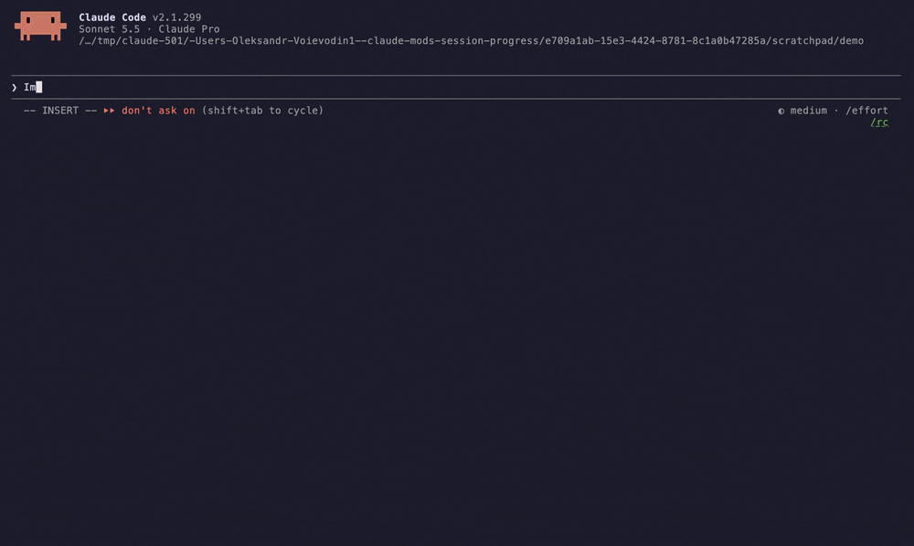

<div align="center">

# session-progress

**A live progress band for long Claude Code tasks, and a short summary when they finish.**

[](LICENSE)
[](https://docs.claude.com/en/docs/claude-code/plugins)
[](#good-to-know)



</div>

## Install

At the prompt of a Claude Code terminal session:

```
/plugin install session-progress --marketplace VAlux/claude-session-progress
```

Answer `y` to add the marketplace, then pick a scope. The user scope loads it in every session. It starts working in the current session right away.

## What it shows

| | |
| --- | --- |
| **While Claude works** | A pulsing spinner and the step Claude is on, an animated bar, elapsed time, and a row of counts: tool calls, subagents, files changed, model steps, tokens and errors. Below them, what is running right now. |
| **When the steps are known** | The bar shows real progress, and the headline names the step in progress. A plan file's steps are listed under the bar with ✓ done, ◐ in progress and ○ to do. A task list's are not, because Claude Code already draws its own. |
| **When it finishes** | The bar fills and turns green, or amber if you interrupted it, or red on an error. The summary lists duration, work done, tokens in and out with the cache share, the model, the most-used tools, and totals for the session. |
| **On your next prompt** | The summary goes away. |

## How progress is measured

| Source | What the bar shows |
| --- | --- |
| A task list (`TodoWrite`, or `TaskCreate` / `TaskUpdate`) | Done ÷ total, with the task in progress counting as half |
| A Markdown plan with `- [ ]` / `- [x]` boxes that Claude reads or edits | Ticked ÷ total, moving forward as boxes are ticked |
| A plan with two or more `### Task N:` headings | Done tasks ÷ total. A task is done when all its boxes are ticked, or when a superpowers ledger reports `Task N: complete`, whether in a Bash call's output (`task-done`) or in its `progress.md` that Claude reads. superpowers' executor never ticks a plan's boxes, so without this its plans stayed at 0%. |
| Neither | A soft streak sweeps the track. There is no honest percentage to show, so it does not invent one. |

A task list wins over a plan file. A plan that is still unfinished carries over to the next turn, and a finished one is cleared. A subagent's own task list never replaces the main one, but a subagent can still mark the main session's tasks done.

The mod also adds one line to the system prompt, asking Claude to keep a task list when a task has several known steps, so the bar has real steps to follow more often.

## When it appears

Quick answers and short Q&A never show the band. It appears once a turn has run:

| | |
| --- | --- |
| 20 s, with at least 3 tool calls | ordinary multi-step work |
| 8 s, with a task list or plan of 2+ steps | planned work, which shows sooner |
| 45 s | anything that runs long |

The thresholds are the constants at the top of [`hooks/register.tsx`](hooks/register.tsx).

## Settings

Change it in `/config`, or with `claude plugin configure session-progress`.

| Setting | Values | What it does |
| --- | --- | --- |
| `stepRows` | **`auto`**, `always`, `never` | When the band lists the steps under its bar. `auto` lists a Markdown plan's steps or tasks only, since Claude Code draws its own task list. `always` lists task lists too, and `never` lists nothing. |

To make the band your only task view, hide Claude Code's own list with `ctrl+t` and set `stepRows` to `always`.

## Good to know

- It draws in the terminal only. Other surfaces show nothing extra.
- Collapse the band at any time with `ctrl+x ctrl+a`, or with the `[-]` mark at its right edge.
- A bug in the mod never blocks a tool call: its tool hook passes the call through if it fails.
- It shares the space above the prompt: another mod's band there (factory-floor's strip, say) is drawn above it, not hidden.
- It is built on Claude Code's function-hooks plugin API, which is in early access and may change between releases.

## Develop

```sh
git clone https://github.com/VAlux/claude-session-progress
claude --plugin-dir ./claude-session-progress     # load the working copy for one session
claude plugin validate ./claude-session-progress
claude plugin test ./claude-session-progress
```

| Path | What it holds |
| --- | --- |
| [`hooks/register.tsx`](hooks/register.tsx) | The hooks: turn and tool tracking, plan files, the system-prompt line, the band |
| [`hooks/frames.ts`](hooks/frames.ts) | Bar and spinner frames, the plan and ledger parsers, formatting |
| [`types/index.d.ts`](types/index.d.ts) | The mod's state contract |
| [`tests/`](tests) | Behaviour tests, run with `claude plugin test` |

The demo in [`docs/`](docs) was recorded with [VHS](https://github.com/charmbracelet/vhs) from [`docs/demo.tape`](docs/demo.tape).

## License

[MIT](LICENSE)
