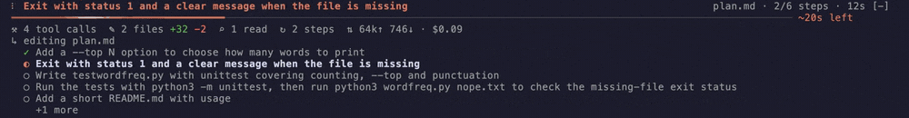
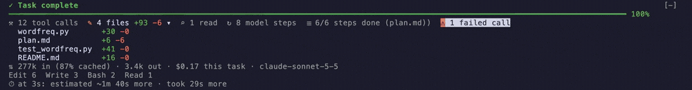
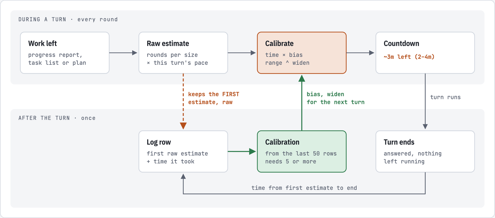

<div align="center">

# session-progress

**A live progress band for long Claude Code tasks, and a short summary when they finish.**

[](LICENSE)
[](https://docs.claude.com/en/docs/claude-code/plugins)
[](#good-to-know)


</div>

## Install

At the prompt of a Claude Code terminal session:

```
/plugin install session-progress --marketplace VAlux/claude-session-progress
```

Answer `y` to add the marketplace, then pick a scope. The user scope loads it in every session. It starts working in the current session right away.

The desktop app's Code tab has no `/plugin` command. Install it from a terminal at the user scope, and the local sessions the desktop app starts load it too.

## At a glance

### While Claude works

Ask Claude for something that takes a while, say *"Implement plan.md step by step"*, and after a few seconds a band appears above the prompt:



Read it top to bottom:

- **`Exit with status 1 and a clear message when the file is missing`**: the step Claude is on now, taken from `plan.md`.
- **`plan.md · 2/6 steps · 12s`**: where the steps come from, how many are done, and how long the turn has run.
- **The bar and `~20s left`**: how much of the work is behind it, and the countdown for the rest.
- **`⚒ 4 tool calls  ✎ 2 files +32 −2  ⌕ 1 read  ↻ 2 steps  ⇅ 64k↑ 746↓ · $0.09`**: what the turn has done so far: tool calls, files changed with lines added and removed, files read, model requests, and tokens in and out with what they cost. Click any of them to see the list behind it.
- **`↳ editing plan.md`**: what is running right now.
- **The steps**: ✓ done, ◐ in progress, ○ still to do.

### When it finishes



The bar fills and turns green, and the band becomes a summary: `✓ Task complete`, 12 tool calls, 4 files changed (opened here, so each file shows its own `+30 −0`), 6 of 6 steps done, one failed call to look into, 277k tokens in (87% of them from the cache) and 3.4k out for **$0.17**, the model, the tools it used most, and a last line comparing the first estimate with how long the turn took. It goes away when you send your next prompt.

### How the countdown is worked out

The countdown doesn't guess from the clock. It counts the work Claude has said is left and prices each piece by what similar pieces took before:

1. **What is left.** Claude reports its remaining items through the mod's `progress` tool, each sized small, medium or large (`s`, `m`, `l`). A task list or a `- [ ]` plan file counts too.
2. **How many rounds each needs.** A round is one model request plus the tools it ran. The mod remembers how many rounds items of each size took in your past turns: say a medium item took 4 rounds and a small one 1½.
3. **How fast rounds go right now.** If this turn's rounds take about 15 s each, then two medium items and one small one are (4 + 4 + 1½) × 15 s ≈ **2m 20s**.
4. **Commands it has timed.** An item that is just running a command, like `npm test`, uses how long that command took the last times it ran in this project.
5. **How your past turns compared.** Once 5 turns are on record, if they tend to take 1.3× their first estimate, because work turned up that the first list didn't name, the time left is scaled to match: **~3m left (2–4m)**.
6. **As items finish**, how they compared with their own estimates corrects the rest, and the range narrows.

Steps 5 and 6 form a loop that runs across turns. When a turn ends, the mod keeps its first estimate (before any correction) beside how long the turn took, and works the correction out again from the last 50 of those pairs:



The log keeps the estimate from before the correction on purpose. If it kept the corrected one, each row would only record what the last correction missed. The correction would then shrink, and turns would start running long again.

Nothing is sent anywhere: what it learns stays in a small file under your Claude Code configuration folder. The details are in [How long is left](#how-long-is-left).

## What it shows

| | |
| --- | --- |
| **While Claude works** | A pulsing spinner and the step Claude is on, an animated bar, elapsed time, and a row of counts, each with its own icon: ⚒ tool calls, ⑂ subagents, ✎ files changed with the lines added and removed, ⌕ files read, ↻ model steps, ⇅ tokens with their estimated cost in USD, and ⚠ errors. Below them, what is running right now. |
| **When you click a count** | Its details open under the row (see [Details](#details)). Click it again to close them. |
| **When the steps are known** | The headline names the step in progress, and the bar moves toward the end as the countdown runs down. A plan file's steps, and the items Claude reports, are listed under the bar with ✓ done, ◐ in progress and ○ to do. A task list's are not, because Claude Code already draws its own. |
| **How long is left** | Once Claude has said what is left, the bar's label counts it down: `~4m left (3–6m)`, then `~1m 30s left`, then `a few seconds left`. It turns amber with `↑` for a few seconds when the estimate grows, and the bar itself never moves back. See [How long is left](#how-long-is-left). |
| **When Claude hands off to a subagent** | A turn that ends while the subagents it started still run says *Waiting for N subagents*, not *Task complete*. Its bar goes on with their countdown instead of filling, and waits where it is while one of them has none. |
| **In a subagent's transcript** | Open a subagent from the tasks list and the band follows that subagent alone: its current task or activity, its own task list or report, its countdown and bar, its tool calls, files, tokens and time. When it answers, the band says *Subagent complete*. A subagent the band never saw (one that started before the mod loaded) gets no band, rather than the main one's. |
| **When it finishes** | The bar fills and turns green, or amber if you interrupted it, or red on an error. The summary lists work done, tokens in and out with the cache share, the estimated cost of the task in USD, the model and the most-used tools, how long the first estimate said the turn would take against how long it took (`⏱ estimated ~7m (4–10m) · took 7m 40s`, when the turn had a countdown and ended with nothing left running), and, from the second turn on, one line of totals for the session, cost included. It leaves the turn's time to Claude Code's own closing line (`Brewed for 5m 59s`). |
| **On your next prompt** | The summary goes away. |

## Details

Each count under the bar is a button. Click it, or focus the band with `ctrl+x tab` and press Enter on it, and the band lists what is behind it. One list is open at a time, and it stays open across turns until you click the count again.

| Count | What it lists |
| --- | --- |
| ⚒ tool calls | A tally by tool, then the latest calls: ✓ done, ◐ running, ✗ failed (with why), and how long each took |
| ⑂ subagents | Each subagent the turn started: its description and type, its calls, output tokens and time, and what it is doing now |
| ✎ files | Each file changed, by name, with the lines added and removed (`a.ts  +12 −3`). Two files with one name show their folder too. Shell commands that changed files they don't name are listed first (`+ shell changes it can't name: git merge`) |
| ⌕ read | The files read, side by side |
| ↻ steps | Time spent in the model and in tools, then each model request: the tools it called, its tokens and its time |
| ⇅ tokens | The estimated cost, input split into fresh, cache read and cache write, output per step, the context at the last step, and the model |
| ⚠ errors | Each failed call, a subagent's marked with ⑂, and why it failed |
| ☰ tasks | In the summary: the task list or plan steps, with ✓ ◐ ○ |

A list shows its latest rows, with a `+N earlier` (or `+N more`) row when others do not fit. Press that row to list them all, up to the room the band has, and press `▴ show fewer` to go back. Closing the list or opening another one starts it capped again.

The summary keeps the finished turn's details, so you can open them after the turn ends. Line counts come from each edit's own patch. A notebook edit, or a rewrite of a file too large to diff, has no line count, and its file reads `changed` instead.

Files changed through Bash count too, as far as the command's text tells: a redirect, `tee`, `sed -i`, `perl -pi`, `rm`/`mv`/`cp`, `git mv`/`rm`/`restore`, and a Python, Node or Ruby script that writes a literal path. These read `changed`. Some commands change files without naming them: `git merge`, `git checkout` of a branch, `git stash pop`, `prettier --write`, a script that writes a path it computes. After one of those, the count reads `3 files changed (+ shell edits)`, or `files changed by shell` when that is all the turn changed, because the real number may be higher.

## How progress is measured

| Source | What the countdown counts |
| --- | --- |
| Claude's own report, through the mod's `progress` tool | The items Claude says are left, each sized `s`, `m` or `l`, or named by the command that running is the item. Claude Code draws nothing for them, so the band lists them under the bar, each with its estimate. |
| A task list (`TodoWrite`, or `TaskCreate` / `TaskUpdate`) | The tasks not yet done, the one in progress by what is left of it |
| A Markdown plan with `- [ ]` / `- [x]` boxes that Claude reads or edits | The boxes not yet ticked |
| A plan with two or more `### Task N:` headings | The tasks not yet done. A task is done when all its boxes are ticked, or when a superpowers ledger reports `Task N: complete`, whether in a Bash call's output (`task-done`) or in its `progress.md` that Claude reads. superpowers' executor never ticks a plan's boxes, so without this its plans never moved. |
| None of these | A soft streak sweeps the track. There is nothing to count down, so it does not invent a number, and the bar carries no label: the clock is on the row above. |

A report wins over a task list for the countdown, and a task list over a plan file; the rows under the bar and the `2/5 tasks` count keep following a task list or plan when there is one. A plan that is still unfinished carries over to the next turn, and a finished one is cleared; a report belongs to its turn. A subagent's own task list, report or checklist file (superpowers' task brief, say) never replaces the main one, but a subagent can still mark the main session's tasks done or tick its plan. Its own drives its own band instead.

The mod adds two lines to the system prompt: one asking Claude to keep a task list when a task has several known steps, one asking it to report what is left with the `progress` tool when it has not, starting with its first tool calls. How to report is left to the tool's own description, which Claude sees anyway: items of a few words, `done` rather than the whole list again as items finish, and no last report once the work is done, since the turn ending closes the list. Claude does not always follow that line, so a turn that reaches 5 tool calls with no report, task list or plan gets one reminder, attached to that call's result, which the transcript does not show. Claude also often works through its reported items without saying they finished, which leaves the first one shown in progress throughout; so once a report has stood unchanged for 8 rounds with items still listed, the next call gets one reminder that names the item shown in progress and asks Claude to send `done` if it finished, unless it is about to answer. Each new report can bring one such reminder.

## How long is left

Each item is worked out in rounds (a model request and the tools it ran), from how many rounds items of its size took in your past turns (built-in guesses until there are some), times how long this turn's rounds take. History stores rounds, not seconds, so a slower model or a higher effort changes the pace, not the history. A `run` item's estimate is that command's own measured time in this project: the band times every foreground Bash call. As the turn goes, how its finished items compared with their estimates corrects the rest. When Claude answers with one item still listed, that item counts as finished when the answer began.

The range, `(3–6m)`, comes from how much those past times varied. It narrows as items finish. The bar moves at the speed that reaches the end with the countdown, slows when the work grows, and waits at 97% until the turn ends.

It also checks itself against your past turns. Each turn's first estimate is kept beside what the turn took, and once 5 turns are on record, the last 50 correct the estimates that follow: the time left is scaled by how much longer (or shorter) turns took than first estimated, often because work turned up that the first list did not name, and the range is widened or narrowed until about 6 turns in 10 would have landed inside it. With few turns on record the correction counts for less, and within a turn it gives way to the turn's own items as they finish. It applies to the time left as a whole, not to each item's own estimate, and leaves a command's measured time as it is.

There is no countdown before Claude has said what is left — a report, a task list or a plan — while the turn waits on a subagent that has none, once Claude reports nothing left yet keeps working, and once an item runs far past its range (twice its top) with no report for 12 rounds.

What it learns is kept in the mod's own store, a JSON file under your Claude Code configuration directory: samples per size, the last 10 run times of each command per project, kept by a hash of the command rather than its text, and each turn's first estimate, as shown and before that correction, against what followed (the last 200), which is what the correction is worked out from, and how its accuracy can be judged on your own turns. Each report is a tool call Claude makes alongside its others: tens of output tokens, and no extra model request. The tool's definition also adds a few hundred input tokens to each request, and a report Claude sends on its own costs a round. Most of those were a last `done` sent just before the answer, which is why Claude is asked to skip it. Each reminder, when a turn gets one, is under 100 input tokens. Its rows are hidden from the transcript.

## When it appears

Quick answers and short Q&A never show the band. It appears once a turn has run:

| | |
| --- | --- |
| 20 s, with at least 3 tool calls | ordinary multi-step work |
| 8 s, with a task list, plan or report of 2+ steps | planned work, which shows sooner |
| 45 s | anything that runs long |

The thresholds are the constants at the top of [`hooks/register.tsx`](hooks/register.tsx).

## Settings

Change it in `/config`, or with `claude plugin configure session-progress`.

| Setting | Values | What it does |
| --- | --- | --- |
| `stepRows` | **`auto`**, `always`, `never` | When the band lists the steps under its bar. `auto` lists a Markdown plan's steps and the items Claude reports, since Claude Code draws its own task list. `always` lists task lists too, and `never` lists nothing. |
| `eta` | **`on`**, `off` | Whether the band counts down the work left. `off` registers no tool, adds no prompt line, records nothing, and the bar shows the share of a task list or plan done, as before 0.2.0. |

To make the band your only task view, hide Claude Code's own list with `ctrl+t` and set `stepRows` to `always`.

## Good to know

- It draws in the terminal and in the desktop app. On the desktop the bar and spinner are vector drawings that animate themselves, and the finish lands at once instead of easing in. The VS Code extension and the mobile app have no band above the prompt, so they show nothing extra.
- Costs are estimates: each model step's tokens at Anthropic's list prices (the table at the top of [`hooks/frames.ts`](hooks/frames.ts)), subagents included. A model missing from the table adds nothing, and a plan's discount or a different provider's rate is not reflected.
- The countdown is an estimate: early on it rests on few items and Claude's own sizing, and the summary's `⏱` line shows how far off it was.
- A command's learned time includes any wait for you to approve it, so a run you approved slowly reads long until later runs push it out. A refused command is never learned.
- Collapse the band at any time with `ctrl+x ctrl+a`, or with the `[-]` mark at its right edge.
- A bug in the mod never blocks a tool call: its tool hook passes the call through if it fails.
- It shares the space above the prompt: another mod's band there (factory-floor's strip, say) is drawn above it, not hidden.
- It is built on Claude Code's function-hooks plugin API, which is in early access and may change between releases.

## Develop

```sh
git clone https://github.com/VAlux/claude-session-progress
claude --plugin-dir ./claude-session-progress     # load the working copy for one session
claude plugin validate ./claude-session-progress
claude plugin test ./claude-session-progress
```

| Path | What it holds |
| --- | --- |
| [`hooks/register.tsx`](hooks/register.tsx) | The hooks: turn and tool tracking, plan files, the system-prompt lines, the band |
| [`hooks/details.ts`](hooks/details.ts) | What each count opens onto: the per-call, per-file and per-step records, line counting, and the detail rows |
| [`hooks/eta.ts`](hooks/eta.ts) | The countdown: pace, each item's spread, the total, the fill, and what a loop learns |
| [`hooks/report.ts`](hooks/report.ts) | The `progress` tool, its prompt line, and reading reports into a work list |
| [`hooks/history.ts`](hooks/history.ts) | The countdown's samples in the mod's store |
| [`hooks/frames.ts`](hooks/frames.ts) | Bar and spinner frames (terminal cells, desktop SVG), the plan and ledger parsers, formatting |
| [`types/index.d.ts`](types/index.d.ts) | The mod's state contract |
| [`tests/`](tests) | Behaviour tests, run with `claude plugin test` |

The demo in [`docs/`](docs) was recorded with [VHS](https://github.com/charmbracelet/vhs) from [`docs/demo.tape`](docs/demo.tape). The two band screenshots under [At a glance](#at-a-glance) are frames cut from it.

## License

[MIT](LICENSE)
